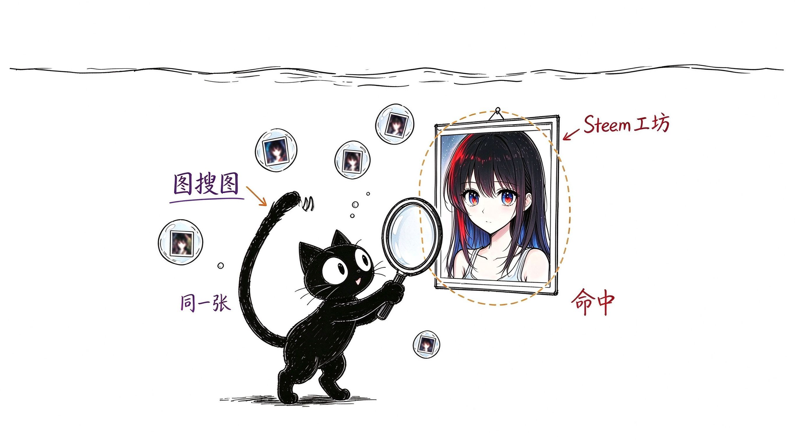
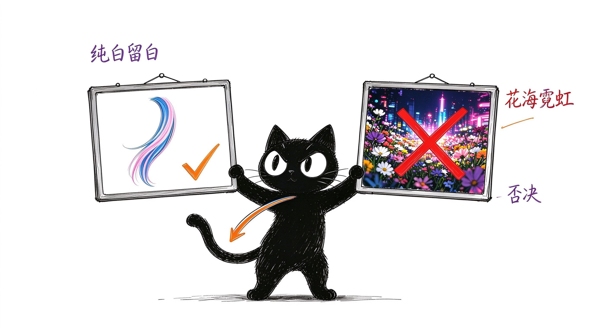
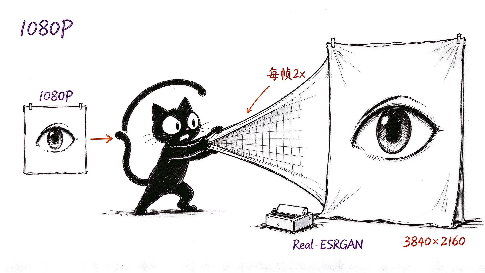
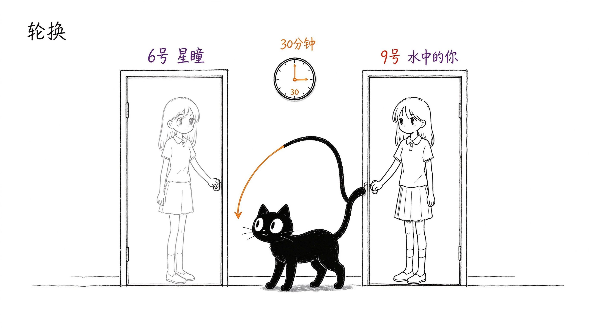

# 壁纸实验室笔记

> 与 AI 协作，把 Windows 桌面变成一座流动的小美术馆。
> 一段完整的实践记录：审美、寻源、超分、自动化。

纯白、极简、手绘、小黑 —— 风格与壁纸一致，克制而雅致。

---

## 亮点

- **审美第一要义**：纯白/浅色底 > 极简留白 > 梦幻光晕；少女上半身动态、蓝粉渐变流光发；花海、城市、电竞、霓虹高饱和一律否决。
- **找到"同一张"**：不是风格相似，而是参考图本人的动态原版。截图 + 视觉反搜 + Steam 工坊溯源，层层锁定。
- **1080P → 4K**：工坊原版没有原生 4K，用 AI 逐帧超分，自己造一张 4K 动态壁纸。
- **一套可复用的切换 skill**：编号、名字、随机、上一张，一句话换壁纸。
- **30 分钟轮换**：两张心头好自动交替，桌面永远新鲜。



---

## 审美：先立规矩，再谈好看

选壁纸的第一判据是**底色与留白**，不是元素多少：

- 纯白/浅色底，极简留白为第一要义；
- 蓝粉渐变流光发、水润透亮感，可以加分；
- 花海、城市夜景、电竞、霓虹高饱和背景，直接否决；
- 动态优先：mpv 硬解，轻量不打扰。



---

## 寻源：找到参考图"本人"的动态版

经验：用户给一张参考图，要的是**这张图自己的动态版**，不是风格相似的替代品。相似候选（水下少女、面部特写、水波纹）统统被否决。

途径与链路：

| 步骤 | 手段 |
|---|---|
| 反向定位 | 参考图 + 视频封面做视觉反搜，锁定作者与系列 |
| 工坊溯源 | Steam 工坊 `we_search` / `we_download`（WEave 工具链，无需购买 Wallpaper Engine） |
| 逐集比对 | 下载系列全部预览，抽帧比对，确认"就是这一张" |
| 备用渠道 | wallpaperwaifu（免工坊直链） |

确认：Steam 工坊「水中的你 (3)」，作者共 8 集 + 星之眼 5 集，均为 1080p 循环视频。

---

## 超分：没有原生 4K，就造一张

工坊原版 1920×1080、5.13s 无缝循环。要 4K，原生没有，用 AI 超分：

```text
ffmpeg 抽帧(154帧, qscale 1) 
  → Real-ESRGAN animevideov3 逐帧 2x（双实例并行，单帧约 17.8s）
  → ffmpeg 合并（30fps, crf 17, faststart）
  → 3840×2160 4K 动态壁纸（24.5MB）
```

要点：抽帧用 `-qscale:v 1 -qmin 1 -qmax 1 -fps_mode vfr` 保细节；合并用 `-c:v libx264 -crf 17 -preset medium`；AMD 集显 Vulkan 也能跑。



---

## 切换 skill：一句话换壁纸

`wallpaper-switcher` 技能沉淀为两个脚本（`scripts/`）：

```text
python switch_wallpaper.py --list                 # 编号清单
python switch_wallpaper.py --switch 6             # 按编号切换
python switch_wallpaper.py --switch "星瞳"        # 按名字模糊切换
python switch_wallpaper.py --random / --back / --now
```

踩过的坑，都已内化为脚本行为：

- 池内切换**不要** `-Copy`（自复制报错）；
- `--back` 记录的是**切换前**的壁纸，不是目标；
- 编号优先、名字其次，多命中时精确优先。

---

## 轮换：30 分钟自动交替

`rotate_wallpapers.py` 在指定编号间按顺序循环：

```text
python rotate_wallpapers.py --set "6,9"   # 配置轮换名单
python rotate_wallpapers.py --once        # 手动切下一张
python rotate_wallpapers.py --show / --stop
```

调度经验：**系统定时任务最小间隔 1 小时**，30 分钟级轮换改用 Windows 计划任务（`Register-ScheduledTask`，`RepetitionInterval = 30 分钟`），零调度开销，只在用户登录时运行。



---

## 踩坑与优化（总账）

| 坑 | 解 |
|---|---|
| DPI 150% 下壁纸模糊、被裁切 | 所有窗口操作前 `SetProcessDpiAwarenessContext(-4)`（per-monitor v2） |
| 中途杀进程留下残留 mpv / WorkerW | 停旧进程 → 静态兜底重置桌面层 → 再启动完整链路 |
| mpv 周期性被还原成小窗口 | `wallpaper-watcher.ps1` 每 2 秒 SetWindowPos 拉回全屏并垫层 |
| config.ini 周期性崩溃 | `autoPauseFeature=false`（否则每 100ms 切 pause）、`forceAutorefresh=false` |
| ps1 中文注释解析失败 | 脚本必须 UTF-8 with BOM（PowerShell 5.1 按 GBK 解码） |
| 重量级方案 | 不用 Wallpaper Engine（~480MB）、Lively（CEF 壳）、Desktop Mate |

优化共识：**轻量优先**——AutoWall（mpv d3d11va 硬解，约 250MB 内存），开机自启即恢复。

---

## 安装与使用

### 环境

- Windows 10/11，PowerShell 5.1+，Python 3，FFmpeg，git
- AutoWall：`AutoWall.exe`（AutoIt + weebp + mpv），壁纸池目录 `VideosHere`

### 步骤

1. 把壁纸视频放进壁纸池（`VideosHere`，支持 mp4/webm/mov/mkv/gif）；
2. 配置 `scripts/` 中两个脚本顶部的路径常量（`VIDEOS_HERE`、`APPLY_PS1`）；
3. 切换：`python scripts/switch_wallpaper.py --switch 6`；
4. 轮换：先 `--set "6,9"` 再注册计划任务，或直接 `--once` 手动换。

### 常用命令速查

```text
python switch_wallpaper.py --list          # 看编号
python switch_wallpaper.py --switch 9      # 换 9 号
python switch_wallpaper.py --back          # 回上一张
python rotate_wallpapers.py --set "6,9"    # 定轮换名单
python rotate_wallpapers.py --once         # 手动轮换一次
```

> 详细链路（工坊下载、Scene 渲染、超分脚本）见 `windows-live-wallpaper` 技能文档。
